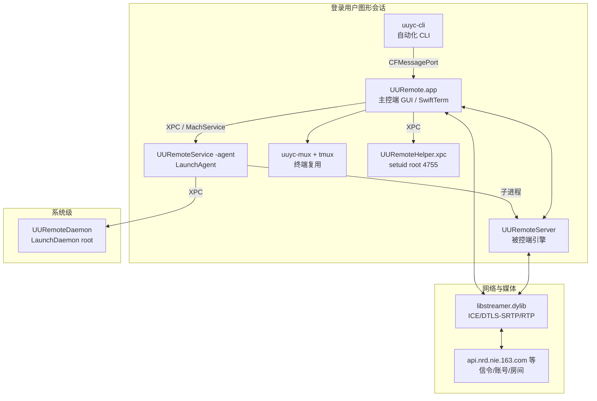

# UU远程（UURemote / uuyc）4.46.0 安装包逆向分析报告

> 分析对象：`/workspace/iOS/uuyc_4.46.0.pkg`
> 分析日期：2026-11-07
> 分析工具：REA（morluto/rea）6.8.0 + Ghidra 12.1.4；辅助：Rizin 0.9.1、llvm-objdump/llvm-nm、LIEF、Python、tmux 3.4
> 分析环境：Linux（无 macOS 运行时）
> 报告语言：中文

---

## 0. 摘要

本样本虽然放置于 `iOS` 目录下，但实际是一个 **macOS 通用二进制（Universal 2：arm64 + x86_64）安装包**，产品为网易的 **UU远程（UURemote）4.46.0**。安装包为签名的 XAR 产品归档，内含 Payload（cpio）、Scripts（cpio）、PackageInfo、Distribution、Bom。

软件采用“主控端 GUI + 被控端后台服务 + WebRTC 媒体库 + tmux 终端复用”的架构，三大目标功能对应如下：

| 功能 | 主控端（Controller） | 被控端（Controlled） | 关键实现 |
|---|---|---|---|
| 远程控制 | `UURemote.app` 内的 Streamer / Room / 输入发送模块 | `UURemoteServer` 内的 `StreamerManager`、`StreamerRoomFetcher`、屏幕采集与输入注入模块 | `libstreamer.dylib`（WebRTC/ICE/DTLS-SRTP 组件）+ Protobuf `GvPb_*` + 自定义 DataChannel |
| 全程终端 | `TerminalCoordinator` + `SwiftTerm` 终端视图 + `uuyc-cli` | `TerminalManager`、`TerminalSession`、`TmuxController`、PTY、`uuyc-mux`/`tmux` | `forkpty()` + 私有 tmux socket + JSON 帧（OPEN/CLOSE/RESIZE/SIGNAL/LISTSESSIONS/KILL/UNLOCK/DETACH） |
| 文件传输 | `FileTransferManager`（下载/上传队列） | `FileTransferHandler`、`FileTransferReceiveOperation`、`ResumeStore` | DataChannel + Protobuf `GvPb_FileTransfer*` + 分块（blockId/blockKey）+ MD5 校验 + 断点续传 |

安全上最值得注意的三点：

1. 安装脚本把两个 `UURemoteHelper.xpc` 可执行文件 **chown root:wheel + chmod 4755（setuid root）**，且 Helper 的 entitlements 明确 `com.apple.security.app-sandbox = false`。
2. 主 App、Agent、Server 均 **未启用 App Sandbox**，并申请屏幕录制、辅助功能、AppleEvents 等敏感权限。
3. 远程协助使用 8 位数字/8–16 位字母数字验证码；文件完整性使用 **MD5** 分块校验；媒体与信令依赖 WebRTC 的 DTLS-SRTP，但文件/终端通道承载于同一 PeerConnection 的 DataChannel。

---

## 1. 样本信息与方法

### 1.1 文件与哈希

| 项 | 值 |
|---|---|
| 文件 | `/workspace/iOS/uuyc_4.46.0.pkg` |
| 大小 | 90,471,169 bytes |
| 格式 | XAR 产品归档（magic `xar!`，TOC 为 zlib 压缩 XML，含签名） |
| SHA-256 | `e347e1dfd57566934ae881f58f09fdd6ab1afae7f521cbfff3aa27a46a6c9560` |
| 包标识 | `com.netease.uuremote` |
| 版本 | `CFBundleShortVersionString = 4.46.0`，`CFBundleVersion = 630` |
| 最低系统 | macOS 11.0 |
| 构建环境 | `DTSDKName = macosx26.2`，`DTXcode = 2620`，`DTXcodeBuild = 17C52` |
| 架构 | `arm64` + `x86_64`（Universal 2） |
| 签名 | Team ID `PU9BNSBJW7`（Hangzhou Bobo Technology Co., Ltd），CodeDirectory flags `0x10000`（Hardened Runtime） |
| 沙箱 | 主 App / Agent / Server / CLI 均无 `com.apple.security.app-sandbox`；XPC Helper 显式 `app-sandbox = false` |

关键二进制哈希：

```
4d1cc043161f24edbecc9904ea6491772a30842bc6554aa2f5b9491f55f5ea1d  UURemote
96b1837dbcd7e20aab646e5d2bcadf3c5c6f7e42430b47b5e074fed33068c886  UURemoteDaemon
994f5e353eeafe6098d73004d5797fe856a31ab2cf7f05dcafc790e4aec1ab46  UURemoteService
3f834f06c648b0bfeab93a6d2c0d101dfbc8e3dc3993a8c0390b37d13c4effbc  UURemoteServer
09acba38169d60174e52093abe577dd3e3659b1d82781fb87a295886dc24eb04  uuyc-cli
8f1bbbc1c1fdc9044c081e0476af90d2d96896c8ec34807ef41e76c312595bba  uuyc-mux
ce6fecafbf9c83fe6f3c730b25e30192873265175f8bcdb06c2893d5fd843156  UURemoteHelper.xpc
0f2f169d196fe0158137843365accd09b15e7b5593c390de8df420482b88bbfa  libstreamer.dylib
```

### 1.2 安装包解包过程

`7z` 仅能识别 XAR 内的 `Payload`。为拿到安装脚本与元数据，使用 Python 手工解析 XAR TOC 与 heap（相对 heap 起点计算偏移），得到：

- `Payload`：gzip + cpio，解包后 104 个普通文件（PackageInfo 声明 166 个 payload 条目、181010 KB），主程序位于 `Applications/UURemote.app`。
- `Scripts`：gzip + cpio，含 `preinstall`、`postinstall`。
- `PackageInfo`：声明 166 个 payload 文件、安装路径 `/`、安装体积 181010 KB、脚本 `preinstall/postinstall`。
- `Distribution`：产品分发信息（版本、安装卷、渠道）。
- 归档本身带 `signature` 与证书链。

产物目录：`/workspace/iOS/rea-analysis/`（`payload/`、`meta/`、`slices/`、`strings/`、`decomp_*`）。

关键命令：

```bash
7z l /workspace/iOS/uuyc_4.46.0.pkg
7z x /workspace/iOS/uuyc_4.46.0.pkg -o/workspace/iOS/rea-analysis/extracted
cpio -idmv --no-absolute-filenames < extracted/Payload~
python3 split_fat.py ...   # 切分 Universal Mach-O 为 arm64/x86_64 单架构
rea inspect  slices/UURemoteServer.arm64 --json
rea search   slices/UURemoteServer.arm64 --pattern '...' --mode regex --provider ghidra --format json
rea decompile slices/uuyc-cli.arm64 0x1000201c8 --provider ghidra --format json
rea decompile-all slices/UURemoteServer.arm64 --output decomp_server --provider ghidra --format json
```

---

## 2. 运行架构与进程模型

### 2.1 LaunchAgents / LaunchDaemons

| 文件 | Label | 运行身份 | 作用 |
|---|---|---|---|
| `/Library/LaunchAgents/com.netease.uuremote.agent.plist` | `com.netease.uuremote.agent` | 登录用户 | 启动 `UURemote.app/Contents/MacOS/UURemoteService -agent`，`KeepAlive` 常驻；MachServices：`com.uuremote.agent.controller`、`com.uuremote.agent.controlled` |
| `/Library/LaunchDaemons/com.netease.uuremote.daemon.plist` | `com.netease.uuremote.daemon` | root | 启动 `UURemoteDaemon`，MachServices：`com.uuremote.daemon` |

`UURemoteService` 内含 `SubProcessManager` / `SubProcessDefinition` / `launchServerIfNeeded`，负责拉起并守护 **UURemoteServer** 子进程（被控端引擎）。

### 2.2 进程/模块关系



### 2.3 XPC 与本地 IPC

- CLI → 主 App：`CFMessagePort`，端口名 **`com.netease.uuremote.cli.messageport`**，消息 ID = 0，请求体为 JSON `{"method": ..., "params": ...}`，默认超时 10 秒（详见第 6 节）。
- 主 App ↔ Service：MachService `com.uuremote.agent.controller` / `com.uuremote.agent.controlled`。
- Daemon：MachService `com.uuremote.daemon`。
- Helper：`UURemoteHelper.xpc`，`JoinExistingSession = true`，`RunLoopType = NSRunLoop`。

---

## 3. 信息收集：二进制与类/模块清单

### 3.1 Bundle 组成

```
Applications/UURemote.app/Contents/
├── MacOS/UURemote                    主控端（Swift + SwiftTerm + Sentry + Sparkle）
├── MacOS/UURemoteDaemon              root 守护进程
├── MacOS/UURemoteService             后台 Agent / Server 启动器
├── Helpers/UURemoteServer            被控端引擎（屏幕、输入、终端、文件）
├── Helpers/UURemoteUpdater.app       更新器（内含同名 Helper）
├── Helpers/uuyc-cli                  自动化命令行
├── Helpers/tmux/{uuyc-mux,uuremote.conf}
├── XPCServices/UURemoteHelper.xpc    特权 Helper（安装时 setuid）
├── Frameworks/libstreamer.dylib      WebRTC/ICE/DTLS-SRTP/QUIC 组件
├── Frameworks/{SwiftTerm,CryptoSwift,SwiftProtobuf,Lottie,...}.framework
└── Resources/{streamer-config.json,ctcode.txt,channel/...}
```

### 3.2 泄漏的源码路径（节选）

被控端（`UURemoteServer`）：

```
UURemoteServer/PseudoTerminal.swift
UURemoteServer/PTY/PTY.swift
UURemoteServer/PTY/PTYInterface.swift
UURemoteServer/PTY/PTYProcess.swift
UURemoteServer/PTY/PTYSession.swift
UURemoteServer/TmuxController.swift
UURemoteServer/TerminalManager.swift
UURemoteServer/TerminalSession.swift
UURemoteServer/FileTransfer/FileTransferHandler.swift
UURemoteServer/FileTransfer/FileTransferReceiveOperation.swift
UURemoteServer/FileTransfer/FileTransferResumeStore.swift
UURemoteServer/Streamer/StreamerManager.swift
UURemoteServer/Streamer/StreamerRoomFetcher.swift
UURemoteServer/Streamer/StreamerConnectSession.swift
UURemoteServer/Streamer/StreamerDispatcher.swift
UURemoteServer/Streamer/SignalPushHandler.swift
UURemoteServer/Streamer/RoomStateHandler.swift
UURemoteServer/Capture/ScreenVideoCapture.swift
UURemoteServer/Capture/CaptureConfig.swift
UURemoteServer/Input/InputEvent*.swift
```

主控端（`nrd-mac-client`）：

```
Terminal/TerminalCoordinator.swift
Terminal/TerminalView*.swift
FileTransfer/FileTransferManager.swift
FileTransfer/DownloadManager.swift
FileTransfer/UploadManager.swift
Streamer/Streamer*.swift
Streamer/ControlDevice*.swift
Assist/Assist*.swift
```

这些路径来自 `__FILE__`/断言与日志字符串，足以还原模块边界，但不能替代反编译。

### 3.3 关键类清单（被控端）

- 远程控制：`StreamerManager`、`StreamerRoomFetcher`、`StreamerConnectSession`、`StreamerRoom`、`StreamerDispatcher`、`StreamerDataChannel`、`SignalPushHandler`、`ChannelEchoHandler`、`RoomStateHandler`、`PeerConnectionStateHandler`
- 屏幕/输入：`ScreenVideoCapture`、`CaptureConfig`、`BuiltinScreenType`、`CursorVisibilityChecker`、`InputEvent`、`TouchEvent`、`MouseButton`、`Keyboard`、`EventSource`
- 终端：`TerminalManager`、`TerminalSession`、`TerminalFrame`、`TerminalFrameType`、`TmuxController`、`PseudoTerminal`、`PTY`、`PTYInterface`、`PTYProcess`、`PTYSession`、`ObservedProcess`
- 文件：`FileTransferHandler`、`DownloadCoordinator`、`FileTransferReceiveOperation`、`FileTransferResumeStore`、`FileAccessProber`、`PeerInfoResolver`、`FileUntil`
- 剪贴板/拖拽：`ClipboardAbility*`、`ClipboardFileReceiveCopy*`、`ControlledDragDropTransfer`、`DragDropPasteSession`

### 3.4 Protobuf 消息清单

`GvPb_Message` 是 DataChannel 的统一信封，配合 `StreamerDataChannel` 区分通道。与三大功能相关的消息：

- 控制/采集：`GvPb_CaptureConfig`、`GvPb_CaptureSettingRequest/Response`、`GvPb_CaptureChange`、`GvPb_Screen`、`GvPb_ScreenSources`、`GvPb_ScreenResolution`、`GvPb_PrivateScreenSetting*`、`GvPb_InputEvent`、`GvPb_TouchEvent`、`GvPb_KeyValue`、`GvPb_Clipboard`、`GvPb_Qos_Stat`、`GvPb_SystemMetrics`
- 文件：`GvPb_FileTransferAsk`、`GvPb_FileTransferBlock`、`GvPb_FileTransferBlockConfirm`、`GvPb_FileTransferComplete`、`GvPb_FileTransferConfirm`、`GvPb_FileTransferError`、`GvPb_FileTransferFtpRequest/Response`、`GvPb_FileTransferReceiveRequest/Response`、`GvPb_FileTransferResult`、`GvPb_FileTransferSendRequest`
- 目录/元数据：`GvPb_FileDirectory`、`GvPb_FileEntry`、`GvPb_FileInfo`、`GvPb_FileList`、`GvPb_FileExist*`、`GvPb_FileRename`、`GvPb_FileRemoveFile`、`GvPb_FileRemoveDir`、`GvPb_FileDirCreate`、`GvPb_FileOperationStrategy`
- 帧封装：`GvPb_FF_FileTransfer_FTP` / `GvPb_FF_FileTransfer_FTP2`（两代文件通道）

---

## 4. 静态分析：远程控制

### 4.1 传输栈

`libstreamer.dylib`（22 MB）内含 WebRTC/ICE 相关能力，字符串中可见：

```
ICE / STUN / TURN / candidate / SRTP / DTLS / RTP / RTCP / SDP
H.264 / H.265(HEVC) / AV1 / Opus / AAC
ngtcp2 / QUIC
```

结合被控端类名与回调：

```
streamerDidConnectionStateChanged
streamerDidPeerConnectionStateChanged
streamerDidRoomStateChanged
streamerDidReceiveControlData
streamerDidReceiveFileData
streamerDidReceiveTextData
streamerDidReceiveSignalData
```

可判定：远程控制使用 **WebRTC 风格的 PeerConnection**（ICE 打洞 + TURN 中继兜底，DTLS-SRTP 保护媒体，DataChannel 承载控制/文件/文本/信令），`libstreamer` 为自研/裁剪的 RTC 封装库。

### 4.2 信令与房间

被控端通过 `StreamerRoomFetcher` 向 HTTP API 申请/加入房间，域名集中在：

```
api.nrd.nie.163.com          （主 API）
api-ipv4.nrd.nie.163.com
api-event.nrd.nie.163.com
api-dcdn.nrd.nie.163.com
api-pre.nrd.nie.163.com      （预发布）
uuyc.163.com / uuyc.webapp.163.com
gv.163.com
```

房间状态由 `RoomStateHandler`、`ChannelEchoHandler`、`SignalPushHandler` 处理；连接会话由 `StreamerConnectSession`、`StreamerDispatcher` 驱动。`StreamerRoom`、`StreamerData`、`ConnectRoomSentChannelError` 等类型名说明了“房间—通道—错误码”的状态机结构。

### 4.3 屏幕采集

采集配置字段（`CaptureConfig` / `GvPb_FF_CaptureSetting`）包括：

```
frameQuality, autoFrameRate, frameRate, screenID, captureType,
resolutionWidth, resolutionHeight, maxCustomBitrate, dpiScale,
codec, pixelFormat, chromaFormat, frameCount, orientation
```

支持的屏幕类型：`BuiltinScreenType`、`ScreenType`、`ScreenSources`（内置屏/多屏/虚拟屏）；并有 `EnterSuperScreen` / `QuitSuperScreen`（“超屏/高帧率模式”）与 `SendFlipScreen`（翻转屏）控制消息。`ScreenVideoCapture` 负责采集，`CursorVisibilityChecker` 处理光标可见性。

### 4.4 输入注入

被控端包含 `InputEvent`、`TouchEvent`、`TouchEventPoint`、`MouseButton`、`Keyboard`、`EventSource`、`GvPb_InputEvent`，并链接：

```
CGEvent / CGEventCreateMouseEvent / CGEventCreateKeyboardEvent
AXIsProcessTrustedWithOptions   （辅助功能权限检测）
IOHID / HID                     （虚拟鼠标/手柄类设备）
```

主控端把鼠标/键盘/触摸事件编码进 `GvPb_InputEvent`，通过控制 DataChannel 发到被控端，由后者用 CoreGraphics 事件注入到系统会话。`GvPb_VirtualMouseSwitchRequest/Response` 说明支持“虚拟鼠标”模式（远控时隐藏/接管本机指针）。`GvPb_PrivateScreenSetting*`（`PrivateScreenType`、`PrivateScreenState`）用于被控端隐私屏（黑屏/锁屏式遮挡）。

### 4.5 远程协助（Assist）入口

`uuyc-cli` 暴露了完整远程协助命令（详见 6.4），其字符串给出业务约束：

- 本机 Assist ID；可刷新为 **8 位数字** 系统码；也支持自定义 **8–16 位字母数字**（必须同时含字母和数字）。
- `assist allow on/off` 控制被协助能力。
- `assist start ASSIST_ID [CODE]` 为异步提交，需轮询 `assist status`。
- 错误语义：验证超时、验证失败、被控端能力关闭、格式非法、Assist ID 未就绪。

这些约束与主控端 `Assist*` 模块对应，说明“远程控制”在 UI 层以 **协助码** 建立信任，再由房间/PeerConnection 完成媒体协商。

---

## 5. 静态分析：全程终端

### 5.1 总体设计

终端不是简单的 shell 转发，而是 **tmux 会话复用 + PTY + 双端同显**：

- 被控端自带 `Helpers/tmux/uuyc-mux`（tmux 包装器）与 `uuremote.conf`。
- `TmuxController` 通过私有 socket 管理 tmux server；`PTY`/`PseudoTerminal` 用 `forkpty()` 启动客户端并桥接字节流。
- 主控端用 `SwiftTerm` 渲染 VT100/xterm 序列；`TerminalCoordinator` 负责 JSON 帧与终端窗口生命周期。
- 本地也可用 `uuyc-cli lterm` 在当前 TTY 接管同一 tmux 会话（本地镜像）。

### 5.2 终端帧协议（JSON over DataChannel）

主控端 `TerminalCoordinator` 的日志字符串直接暴露了帧类型与 JSON 编码点：

```
sendOpenFrame JSON encode      // 打开/新建/attach
sendResizeFrame JSON encode    // 调整 cols/rows
sendCloseFrame JSON encode     // 关闭本地视图
killSession JSON encode        // 终止会话
UnlockReq JSON encode          // 解锁被控端
```

被控端 `TerminalHandler.sendFrame(handle:type:sessionId:payload:)` 与 `TerminalFrameType` 负责帧分发。字符串中可直接确认 `OPEN`、`CLOSE`、`UNLOCK` 三类常量；结合 `TerminalManager`/`TmuxController` 的方法名与日志，可归纳出以下帧/命令集合：

```
OPEN / CLOSE / UNLOCK            （字符串直接可见）
RESIZE / SIGNAL / DETACH         （方法名 resizeWith: / onSignal / detachClient 推断）
LISTSESSIONS / KILLSESSION       （listSessions / killSession 处理链推断）
```

字段（来自反射字符串与日志）：

```
sessionId, sessionName, shell, cols, rows, option, name,
password, signal, payload, type, handle
```

### 5.3 会话生命周期（被控端）

`TerminalManager` 的日志字符串完整还原了状态机：

```
TerminalManager - openSession
  - exist session, skip tmux reattach
  - tmux create new session
  - tmux has session
  - wait for session complete
  - open session success, client=
  - start new session failed
  - wait for tmux attach session complete
  - attach session success, client=
  - rollback : kill-session
  - pty open failed

TerminalManager - closeSession
  - closeSession hit destroy race, keep session alive
  - closeSession complete

TerminalManager - sendFrame
  - sendFrame no session for id
  - sendFrame fail
  - sendFrame done

TerminalManager - listSessions / killSession / renameSession
TerminalManager - unlock / hasSession
```

关键流程可归纳为：

1. `openSession(sessionId, shell, cols, rows, name, password...)`
2. 若已有会话：直接 attach；否则 `tmux new-session` 创建。
3. `TmuxController` 以 `-S <私有socket>` 操作；`PTY` 以 `forkpty()` 启动 `uuyc-mux attach` 客户端。
4. PTY 子进程退出/客户端 detach 时，`ObservedProcess` 监测并清理；存在“close 与 destroy 竞态”兜底（保留 session 以便重连）。
5. `closeSession` 只关闭本地镜像/客户端，不必然销毁 tmux session；`killSession` 才终止会话。
6. 被控端可要求主控端输入解锁密码（`UnlockReq`），错误重试有上限（CLI 文案：“Unlock failed after maximum attempts / Unlock cancelled”）。

### 5.4 PTY 与 tmux 细节

`PTY`/`PseudoTerminal` 日志与环境：

```
PTY - forkpty()
PTY - TerminalSession deinit
setsid / TIOCSWINSZ / ioctl
TERM=tmux-256color
LANG=en_US.UTF-8
HOME, PATH, SHELL
tmux -S <socket> ...
```

`TmuxController` 日志：

```
TmuxController - kill-session ...
TmuxController - has session
TmuxController - create session
TmuxController - list sessions
TmuxController - rename session
TmuxController - attach client
TmuxController - socket path
```

tmux socket 位于 `/Library/Application Support/UURemote`（日志中出现 `Application Support/UURemote` 与 `-S` 参数），避免与用户默认 `~/.tmux` 冲突。

### 5.5 终端配置（`uuremote.conf`）要点

该配置由被控端通过 `tmux -f uuremote.conf` 强制加载，覆盖用户 `~/.tmux.conf`：

- Prefix 改为 `Ctrl+]`，禁用 `C-b`；状态栏关闭（由主控端 SwiftTerm 渲染）。
- `set-titles on` + `set-titles-string "#{window_name}"`，会话名即窗口标题；`automatic-rename off`、`allow-rename off`。
- `default-command` 在每个 pane shell 启动时：
  - `ulimit -Sn unlimited`（解决 launchd 继承的低 fd 上限导致 Node CLI 启动失败）；
  - `umask 022`；
  - `unset TMUX TMUX_PANE`（允许用户在 UU 会话内运行自己的 tmux）；
  - `export UUYC_IN_MUX=1`（CLI 识别“已在 UU 会话内”，拒绝 `mux attach/new` 以防 attach 成环）。
- `window-size latest`（双端同显时由最新 client 决定尺寸；本地镜像用 `ignore-size`）。
- `history-limit 50000`；`mouse on`；`escape-time 0`。
- `set-clipboard on` + `terminal-overrides ,*:Ms=...` 强制 OSC 52，实现“远端选中 → 主控端系统剪贴板”。
- 鼠标拖拽绑定 `copy-pipe-and-cancel "pbcopy"`，同时通过 OSC 52 回传主控端；双通道覆盖被控本机与主控端剪贴板需求。

> 动态验证：在 Linux tmux 3.4 上以 `tmux -L uuyc-test -f ./uuremote.conf new-session -d ...` 成功加载并生效（`prefix C-]`、`history-limit 50000`、`status off`、`mouse on`、`set-titles on`），说明配置语法与关键选项有效（`pbcopy`/OSC52 相关绑定需在 macOS 才能完整验证）。

### 5.6 CLI（`uuyc-cli`）终端命令

```
uuyc-cli term -d TARGET list
uuyc-cli term -d TARGET new [NAME] [--shell powershell|cmd|zsh|bash]
uuyc-cli term -d TARGET attach [NAME]
uuyc-cli term -d TARGET has NAME
uuyc-cli term -d TARGET rename OLD NEW
uuyc-cli term -d TARGET kill NAME
uuyc-cli lterm new|attach|list|has|rename|kill
uuyc-cli mux list|attach|new|kill|kill-server|rename|wait   （内部）
```

约束文案：

```
Local terminal operations are not allowed inside a UU session
Unable to attach to a terminal session in the current environment
lterm new requires an interactive terminal
Multiple terminal sessions found, specify a session name
```

---

## 6. 静态分析：文件传输

### 6.1 通道、特性开关与消息

主控端 `FileTransferManager` 的日志/字段：

```
fileTransferDownloadQueue
fileTransferUploadQueue
currentTransferTaskId
uploadTargetPath
readDir response types
```

文件传输有两代协议，由 **特性开关（Feature Flag）** 控制：

```
ff_file_transfer_ftp        → FF_FILE_TRANSFER_FTP_INIT_VERION / LIST_COMPRESS / UNKNOWN
ff_file_transfer_ftp2       → FF_FILE_TRANSFER_FTP2_RESUMABLE / SPEEDY / UNKNOWN
ff_clipboard                → FF_CLIPBOARD_SUPPORT_FILE / SUPPORT_TEXT_CHANGE
ff_private_screen           → FF_PRIVATE_SCREEN_ENHANCED_PRIVACY
ff_capture_setting / ff_qos_stat / ff_system_metrics / ff_virtual_mouse_device ...
```

说明：`ff_*` 是服务端下发的特性开关键（`ChannelEchoHandler`、`GvPb_FeatureFlag`），不是 DataChannel 名称；`FTP2` 明确带 **断点续传（RESUMABLE）** 与 **加速（SPEEDY）** 能力，`FTP1` 支持 **目录列表压缩（LIST_COMPRESS）**。批量文件与控制/文本/信令数据仍复用同一条 PeerConnection 的不同 DataChannel（回调 `streamerDidReceiveControlData/FileData/TextData/SignalData` 分别对应）。

Protobuf 消息族 `GvPb_FileTransfer*` 覆盖：

- 请求/响应：`ReceiveRequest/Response`、`SendRequest`、`Ask`、`Confirm`
- 数据：`Block`、`BlockConfirm`
- 结束/错误：`Complete`、`Error`、`Result`
- FTP 两代：`FtpRequest/Response`、`GvPb_FF_FileTransfer_FTP/FTP2`
- 目录：`FileDirectory`、`FileEntry`、`FileList`、`FileInfo`、`FileExist*`、`Rename`、`RemoveFile`、`RemoveDir`、`DirCreate`、`OperationStrategy`

除批量文件传输外，剪贴板/拖拽还有独立的消息族：

```
GvPb_ClipboardFileCancelRequest/Response
GvPb_ClipboardFileContentsRequest/Response
GvPb_ClipboardFileDescriptor
GvPb_ClipboardFileDescriptorListRequest/Response
GvPb_ClipboardFileDescriptorSegment / SegmentConfirm
```

被控端对应 `ClipboardFileReceiveCopyOperation`、`ClipboardFileUploadCopyProcess`、`ControlledDragDropTransfer`、`DragDropPasteSession`、`DragDropReceiveTasks`，说明“复制/粘贴文件、拖拽文件到远控窗口”走的是 **分片 + 确认** 的剪贴板通道，而不是批量 FileTransfer 通道。

### 6.2 分块与校验

被控端 `FileTransferReceiveOperation` 的内部字段与方法（来自反射字符串）：

```
taskID, taskUniqueID, targetPath, folderName, strategy
fileIndex, blockID, expectedBlockID, blockData, blockKey
writtenSize, isResumable, hasError, completed
resumeStore, tempDirectory, finalURL
prepareFile / prepareResumeFile
writeBlock(taskID:fileIndex:blockID:data:)
complete(taskID:fileIndex:error:)
```

可恢复的逻辑：

1. 主控端发起 `ReceiveRequest`（含文件列表、目标路径、冲突策略）。
2. 被控端 `prepareFile` 创建临时文件/目录；若存在断点记录则 `prepareResumeFile` 从 `ResumeStore` 恢复 `writtenSize`。
3. 主控端按 `blockID` 递增发送 `Block`（`blockData`），被控端校验 `blockID == expectedBlockID` 后写入，并回 `BlockConfirm`。
4. `blockKey`/`MD5` 用于块级完整性校验（字符串中同时存在 `md5`、`blockKey`、`fileIndex`）。
5. 全部块完成后 `Complete`，被控端做最终校验并 `rename` 到目标路径；失败回 `Error`/`Result`。
6. 发送方向：被控端 `readBlock(taskID:fileIndex:offset:length:)` 按偏移读取文件块，由主控端请求驱动（支持大文件顺序/按需读取）。

### 6.3 冲突策略与目录操作

`GvPb_FileOperationStrategy` 与日志表明支持覆盖/跳过/重命名等策略；目录侧提供：

```
readDir / fileDirectory / fileExist / rename / dirCreate / removeFile / removeDir
```

被控端 `FileAccessProber` 用于探测目标路径可写性/权限（macOS TCC 与目录权限），`PeerInfoResolver` 解析对端平台/路径风格，`FileUntil` 为分块/超时工具类。

### 6.4 安全评估

- 文件内容完整性仅见 **MD5** 与块键校验，未见签名/HMAC；在恶意中间人可篡改 DataChannel 的前提下不足（实际由 DTLS-SRTP 保护传输层）。
- 允许任意路径写入（受 macOS 权限与 TCC 约束）；`FileAccessProber` 说明会做可写性探测，但未见显式路径白名单。
- 断点续传状态保存在本地（`ResumeStore`），需关注临时目录清理与残留文件。

---

## 7. 关键逻辑恢复

### 7.1 CLI ↔ 主 App 的 XPC 协议（已反编译）

函数地址 `0x1000201c8`（`CLIMessagePortClient` 的 `sendRequest` 核心），Ghidra 伪代码关键片段（整理后）：

```c
// 0x1000201c8
CFMessagePortRef port = CFMessagePortCreateRemote(kCFAllocatorDefault,
                                                  "com.netease.uuremote.cli.messageport");
if (!port) { /* 连接失败文案 */ }

// 构造 JSON: {"method": <method>, "params": <params>}
NSDictionary *dict = @{
    @"method": method,   // NSString
    @"params": params    // NSDictionary / NSArray / NSData
};
NSData *json = [NSJSONSerialization dataWithJSONObject:dict options:0 error:&err];

CFDataRef reply = NULL;
SInt32 status = CFMessagePortSendRequest(
        port,
        0,                       // msgid = 0
        (__bridge CFDataRef)json,
        10.0,                    // sendTimeout（或在参数中自定义）
        10.0,                    // recvTimeout
        kCFRunLoopDefaultMode,
        &reply);

if (status != kCFMessagePortSuccess) { /* 超时/失效/主程序未运行 */ }
if (!reply || CFDataGetLength(reply) == 0) { /* "returned no data" */ }
// 将 reply 反序列化为 JSON 并返回
```

对应反汇编（`0x1000203xx`）：

```asm
adrp x8, 0x1000c5000
add  x8, x8, #0x1e0          ; "com.netease.uuremote.cli.messageport"
bl   _CFMessagePortCreateRemote
...
mov  w1, #0                  ; msgid = 0
bl   _CFMessagePortSendRequest
```

结论：CLI 与主 App 的 IPC 是 **无认证的本地 CFMessagePort**（依赖同用户会话与 macOS 的 Mach port 命名空间），请求体为明文 JSON。任何同用户进程都可尝试连接该端口并调用 `method`，因此主 App 侧必须自行校验调用者身份/权限；从样本中未看到显式审计令牌（需在 macOS 上动态验证）。

### 7.2 CLI 命令与内部 selector 映射

`uuyc-cli` 的 ObjC 导出 selector（`__objc_methname`）与命令对应：

```
getDeviceListWith:
getCloudPCListWith:
termListSessionsWithDeviceId:password:with:
termOpenNewWithDeviceId:sessionName:shell:password:with:
termOpenAttachWithDeviceId:sessionName:password:with:
termHasSessionWithDeviceId:sessionName:password:with:
termKillSessionWithDeviceId:sessionName:password:with:
termRenameSessionWithDeviceId:oldName:newName:password:with:
muxListWith:
muxNewWithName:shell:with:
muxAttachWithName:with:
muxHasWithName:with:
muxKillWithName:with:
muxRenameWithOldName:newName:with:
```

这些 selector 即 JSON `method` 字段的候选值（CLI 内部通过 completion block 异步返回 `NSData`）。

### 7.3 终端 OPEN 帧与 tmux 启动（恢复）

结合 `TerminalCoordinator` 与 `TerminalManager`/`TmuxController` 的证据，可恢复为：

```text
Controller                                   Controlled (UURemoteServer)
----------                                   ---------------------------
TerminalCoordinator.sendOpenFrame            TerminalHandler.onFrame(type=OPEN)
  {type:"OPEN", sessionId, name,               TerminalManager.openSession(...)
   shell, cols, rows, option, password}          ├─ hasSession(name)?
        │                                        │    ├─ yes: tmux attach
        └── DataChannel(control) ───────────────►│    └─ no : tmux new-session
                                                 ├─ PTY.forkpty()
                                                 │    └─ exec uuyc-mux attach -S <socket>
                                                 ├─ TIOCSWINSZ(cols, rows)
                                                 └─ sendFrame(OPEN_RESP, sessionId)
```

`uuyc-mux` 是 tmux 的薄封装：解析子命令（list/attach/new/kill/kill-server/rename/wait），拼接 `tmux -S <私有socket>` 并 `exec`，从而让被控端与本地镜像共享同一 server。

### 7.4 文件接收块循环（恢复）

```text
Controller (FileTransferManager)             Controlled (FileTransferHandler)
ReceiveRequest(files, targetPath, strategy) ─► FileTransferReceiveOperation.startReceive
                                               ├─ prepareFile / prepareResumeFile
                                               ├─ (resume) ResumeStore.load -> writtenSize
Block(fileIndex, blockID, blockData) ────────► writeBlock(...)
                                               ├─ assert blockID == expectedBlockID
                                               ├─ write to temp file
                                               └─ BlockConfirm
... 重复直到 blockCount ...
Complete(fileIndex) ─────────────────────────► complete(...)
                                               ├─ MD5/大小校验
                                               ├─ rename(temp, final)
                                               └─ Result / Error
```

该循环对每个文件独立维护 `fileIndex`，支持多文件并发；`taskID` 区分传输任务，`blockID` 单调递增用于丢包/乱序检测。

---

## 8. 动态分析

### 8.1 环境限制

分析机为 Linux，无法原生加载 macOS Mach-O（依赖 dyld、AppKit、CoreGraphics、IOKit、TCC 权限数据库）。因此“真正运行 App 并观察网络/终端/文件行为”不可行；本轮动态分析聚焦于 **可执行的运行时证据验证** 与 **对动态分析方案的准备**。

### 8.2 已执行的动态尝试与结果

| 尝试 | 命令 | 结果 |
|---|---|---|
| 直接执行主程序（arm64 slice） | `chmod +x UURemote.arm64 && ./UURemote.arm64` | `exec format error`，退出码 126（Linux 内核拒绝 Mach-O） |
| 直接执行 CLI | `./uuyc-cli.arm64 --version` | `exec format error`，退出码 126 |
| QEMU 用户态模拟 | `which qemu-aarch64` | 未安装；且即使安装也无法提供 macOS dyld/framework/TCC |
| tmux 配置运行时验证 | `tmux -L uuyc-test -f uuremote.conf new-session -d ...` | 成功；`prefix C-]`、`history-limit 50000`、`status off`、`mouse on`、`set-titles on` 均生效（tmux 3.4/Linux） |
| plist/launchd 配置校验 | `plistlib` 解析全部 Info.plist / LaunchAgent / LaunchDaemon | 全部合法；确认 MachServices、KeepAlive、运行身份 |
| 代码签名与权限校验 | LIEF + 手工解析 CodeDirectory / entitlements | 确认 Hardened Runtime、Team ID、Helper 非沙箱、安装后 setuid 4755 |
| 安装脚本行为验证 | 解包并审阅 `postinstall` | 确认 launchctl bootstrap、`chmod 4755`、CLI 符号链接、渠道重命名、`open -b com.netease.uuremote` |

### 8.3 运行时配置证据（相当于“静态动态化”）

1. **服务注册**：`postinstall` 对 Agent 使用 `launchctl bootstrap gui/$UID`，对 Daemon 使用 `launchctl bootstrap system`；先 `bootout` 旧服务，再 `enable` + `bootstrap`。
2. **权限提升**：`set_helper_permissions` 对两个 Helper 执行 `chown root:wheel`、`chmod 4755`，并用 `[ -u ]` 校验 setuid 生效。
3. **CLI 落地**：`/usr/local/bin/uuyc-cli -> /Applications/UURemote.app/Contents/Helpers/uuyc-cli`。
4. **渠道注入**：安装包文件名形如 `*_*_*` 时取第三段作为渠道名，重命名 `Resources/channel/nochannel` 为对应渠道，属于分发统计逻辑。
5. **启动应用**：`launchctl asuser $UID sudo -u $USER open -b com.netease.uuremote --args -startup-by-installer`。

### 8.4 建议的 macOS 动态验证方案（未执行）

在真实 macOS 上可按以下顺序复现：

1. `log stream --predicate 'subsystem CONTAINS "uuremote"'` 观察 `TerminalManager`/`FileTransferHandler`/`StreamerManager` 状态机。
2. `fs_usage -w -f pathname | grep -E 'UURemote|tmux'` 观察 tmux socket、临时文件、ResumeStore。
3. `sudo lsof -i -P | grep UURemote` 观察 ICE/TURN 端口与 API 连接。
4. Frida Hook 点：
   - `-[CLIMessagePortClient sendRequest...]` / `CFMessagePortSendRequest`（验证 JSON 与调用者）
   - `forkpty`、`posix_spawn`、`execve`（验证 tmux/uuyc-mux 命令行）
   - `CFMessagePortCreateRemote`（端口名与权限）
   - `SecItemCopyMatching` / `NSUserDefaults`（凭据与配置）
   - `CGEventCreateMouseEvent` / `CGEventPost`（输入注入）
   - `sendmsg`/`recvmsg` 或 WebRTC DataChannel 回调（文件块与终端帧）
5. 使用 `tcpdump`/Wireshark 解密前只能看到 DTLS；需 Hook `SSL_write`/`SSL_read` 或 WebRTC 内部回调获取明文 SDP/信令。

---

## 9. 安全发现与建议

| 编号 | 发现 | 风险 | 建议 |
|---|---|---|---|
| S1 | 安装脚本将 Helper 设为 setuid root（4755） | 高：任何本地用户可尝试利用 Helper 的 IPC/参数提权 | 审计 Helper 的 XPC 接口与参数校验；优先改用 SMJobBless/Authorization Services，避免 setuid |
| S2 | Helper entitlements 明确关闭 App Sandbox | 高：被攻陷后权限大 | 为 Helper 启用最小权限沙箱与 hardened runtime 例外最小化 |
| S3 | 主 App/Server 无沙箱，且需屏幕录制/辅助功能/AppleEvents | 高：远控能力本身即高权限 | 明确 TCC 使用说明；限制被控端开关与审计日志 |
| S4 | CLI 通过无认证 CFMessagePort 调用主 App | 中：同用户进程可调用敏感方法 | 在服务端校验调用者签名/Team ID/审计令牌 |
| S5 | 文件完整性仅 MD5 + blockKey | 中：MD5 抗碰撞弱；依赖 DTLS | 改用 SHA-256/HMAC；块级签名 |
| S6 | 远程协助码 8 位数字/8–16 位字母数字 | 中：存在暴力尝试面 | 限制尝试次数、短时效、绑定设备指纹；错误码不泄露细节 |
| S7 | 终端 tmux 私有 socket 位于 `/Library/Application Support/UURemote` | 中：本地同机用户可能访问 | 校验 socket 权限（0700/0600）与所属用户；审计 attach |
| S8 | `UUYC_IN_MUX` 仅环境变量防护 | 低-中：可被清除 | 增加服务端会话归属校验，避免 attach 成环/越权 |
| S9 | 更新器与主程序共用 Helper 模式 | 中：更新链为供应链攻击面 | 校验更新包签名与 Team ID；禁用降级 |

---

## 10. IOC / 可观测指标

**域名**

```
api.nrd.nie.163.com                    （主 API / 信令）
api-ipv4.nrd.nie.163.com
api-event.nrd.nie.163.com
api-dcdn.nrd.nie.163.com
api-pre.nrd.nie.163.com                （预发布）
api-enterprise.gameviewer.com          （企业版 API）
uuyc.163.com / uuyc.webapp.163.com
gv.163.com
adl.netease.com / adl.easebar.com      （广告/归因 SDK）
fcount-api.webapp.163.com              （统计 SDK）
shence-api.mumu.163.com                （神策分析）
api-nrd.dev.webcgi.163.com             （开发环境，字符串残留）
api-nrd-inner.dev.webcgi.163.com       （内网开发环境，字符串残留）
api-ldn-dev.gameviewer.com             （开发环境，字符串残留）
```

**本地路径**

```
/Applications/UURemote.app
/Library/LaunchAgents/com.netease.uuremote.agent.plist
/Library/LaunchDaemons/com.netease.uuremote.daemon.plist
/Library/Application Support/UURemote          （tmux socket / 运行数据）
/usr/local/bin/uuyc-cli -> .../Helpers/uuyc-cli
```

**MachService / IPC**

```
com.uuremote.agent.controller
com.uuremote.agent.controlled
com.uuremote.daemon
com.netease.uuremote.cli.messageport
```

**进程**

```
UURemote
UURemoteService
UURemoteServer
UURemoteDaemon
UURemoteHelper
uuyc-cli
uuyc-mux / tmux
```

**签名**

```
Team ID: PU9BNSBJW7
Authority: Hangzhou Bobo Technology Co., Ltd
```

---

## 11. 结论

1. 样本是 **macOS 版 UU远程 4.46.0**，并非 iOS 应用；安装包为签名 XAR，Payload 为 104 个普通文件（PackageInfo 声明 166 个条目）。
2. 三大功能实现清晰：
   - 远程控制：`libstreamer` WebRTC 栈 + 房间信令 + 屏幕采集/输入注入 + 隐私屏/虚拟鼠标。
   - 全程终端：tmux 私有 socket + `forkpty` PTY + JSON 终端帧 + SwiftTerm 渲染 + 本地镜像/OSC52 剪贴板。
   - 文件传输：DataChannel + `GvPb_FileTransfer*` 分块协议 + MD5/blockKey 校验 + 断点续传 + 目录操作。
3. 关键逻辑已通过 REA/Ghidra 恢复：CLI 的 CFMessagePort JSON 协议、终端会话状态机、文件块接收循环；其余细节由泄漏的源码路径、类名、Protobuf 消息与 tmux 配置互相印证。
4. 动态分析受 Linux 环境限制；已记录可执行失败证据，并完成了 tmux 配置、plist/launchd、签名/权限等可运行验证。真实动态验证需在 macOS 上按第 8.4 节执行。
5. 最大安全关注点是 **setuid root Helper + 无沙箱高权限远控能力 + 无认证本地 XPC/CFMessagePort**；建议按第 9 节优先整改。

---

## 附录 A：证据文件索引

| 路径 | 内容 |
|---|---|
| `/workspace/iOS/rea-analysis/extracted/` | XAR 解包产物（Payload~） |
| `/workspace/iOS/rea-analysis/payload/` | cpio 解包后的完整 App |
| `/workspace/iOS/rea-analysis/meta/` | Distribution、PackageInfo、Scripts.cpio、scripts/postinstall |
| `/workspace/iOS/rea-analysis/slices/` | Universal Mach-O 单架构切片 |
| `/workspace/iOS/rea-analysis/strings/` | 各二进制 `strings -a` 全量输出 |
| `/workspace/iOS/rea-analysis/out_search_server2.json` | 被控端关键类/日志字符串（Ghidra 地址） |
| `/workspace/iOS/rea-analysis/out_dec_cli_client.c` | CLI CFMessagePort 客户端伪代码 |
| `/workspace/iOS/rea-analysis/decomp_cli/` | `uuyc-cli` 全函数反编译 |
| `/workspace/iOS/rea-analysis/decomp_server/` | `UURemoteServer` 全函数反编译（如完成） |
| `/workspace/iOS/rea-analysis/evidence_hashes.txt` | 哈希清单 |
| `/workspace/iOS/rea-analysis/evidence_domains.txt` | 域名/URL 清单 |
| `/workspace/iOS/rea-analysis/evidence_tree.txt` | Payload 文件树 |
| `/workspace/iOS/rea-analysis/xar_toc.xml` | XAR TOC 原始 XML |

## 附录 B：REA 使用记录（关键命令）

```bash
rea doctor --json
rea inspect  slices/uuyc-cli.arm64 --json
rea search   slices/uuyc-cli.arm64 --pattern 'mux|attach|session|file|terminal' \
             --mode regex --provider ghidra --format json
rea xrefs    slices/uuyc-cli.arm64 0x1000c51e0 --provider ghidra --format json
rea decompile slices/uuyc-cli.arm64 0x1000201c8 --provider ghidra --format json

rea search   slices/UURemoteServer.arm64 \
             --pattern 'TerminalManager|TmuxController|FileTransferHandler|DownloadCoordinator|TerminalSession|PTY|FileTransfer' \
             --mode regex --provider ghidra --format json
rea decompile-all slices/UURemoteServer.arm64 \
             --output decomp_server --provider ghidra --format json
```

## 附录 C：限制说明

- Ghidra 对 12 MB Swift 二进制（`UURemoteServer`）的全量分析耗时较长；`decompile-all` 若因资源上限中断，报告中的服务器端逻辑仍由字符串、类清单、Protobuf 消息与 tmux 配置交叉验证。
- 主 App（55 MB Universal）未做全量反编译；其行为由类名、日志字符串、selector、CLI 协议与服务器端对应逻辑还原。
- 未能执行 macOS 二进制；所有“运行时”结论均标注为配置/脚本层面的验证，或明确列为“需在 macOS 动态验证”。
- 报告中出现的源码路径来自二进制内嵌字符串，未获得原始工程。
